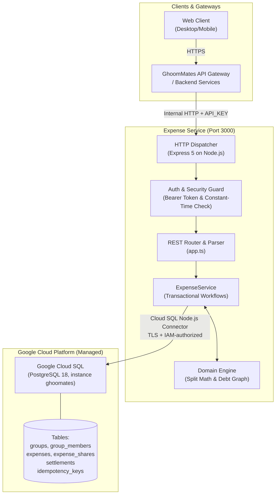
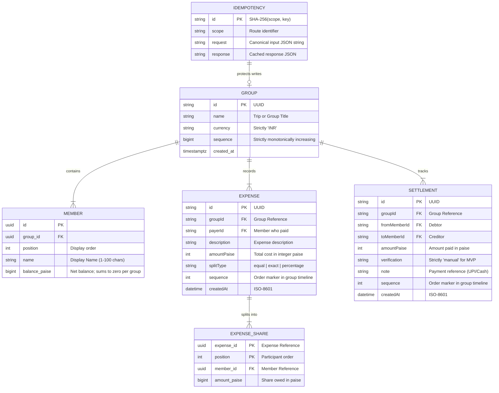
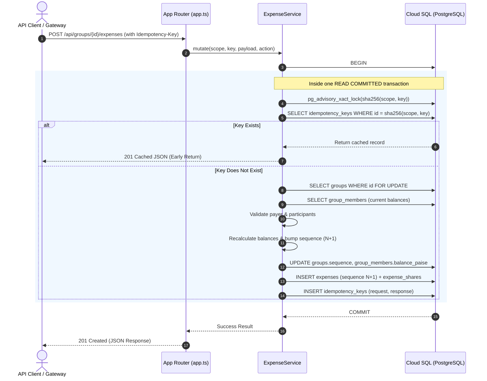

# Backend Architecture & Design Document
**Module:** `expenses`  
**Monorepo Path:** `backend` (module `src/expenses/`, served by the unified backend)  
**Ecosystem:** GhoomMates Travel Companion Platform  
**Runtimes:** Node.js (v22.18+) &bull; **Database:** Google Cloud SQL for PostgreSQL 18

---

## 1. Executive Summary & Core Objectives

The `expenses` module of the unified backend is the component within the **GhoomMates** monorepo responsible for multi-traveler group expense sharing, real-time ledger accounting, debt minimization, and manual settlement verification.

### Key Tenets
1. **Zero Financial Precision Drift**: No floating-point numbers are used for monetary calculations. All amounts are stored and calculated as 64-bit integer **paise** ($1\text{ INR} = 100\text{ paise}$).
2. **ACID Transactional Consistency**: All balance mutations, sequential audit logs, and idempotency states execute within a single Postgres transaction.
3. **Strict Idempotency**: All state-modifying requests require a unique `Idempotency-Key` header hashed via SHA-256 to prevent duplicate charges or double payments.
4. **Platform & Runtime Neutrality**: Runs on standard Node.js, executing the TypeScript sources directly with no build step.

---

## 2. High-Level System Architecture



---

## 3. Data Model & Entity Relationships

The service maintains an append-only transaction history alongside per-member balance aggregates to ensure $O(1)$ balance reads without scanning full historical transactions.



---

## 4. Algorithmic Domain Logic

### 4.1. Lossless Expense Splitting (`splitExpense`)

Splitting currency among $N$ individuals frequently results in non-divisible fractional cents (e.g. splitting ₹100.00 among 3 participants yields $33.3333...$ paise).

To eliminate rounding leaks:
1. Base shares are computed via integer division:
   $$\text{baseShare}_i = \left\lfloor \frac{\text{amount} \times w_i}{\sum w} \right\rfloor$$
2. The remaining undistributed paise:
   $$\text{remainder} = \text{amount} - \sum \text{baseShare}_i$$
3. Fractional remainder paise ($1\text{ paise}$ each) are distributed sequentially to participants sorted by highest fractional modulo, ensuring:
   $$\sum_{i=1}^N \text{shares}_i = \text{totalAmount}$$
   *Guaranteed: Zero paise created or lost.*

### 4.2. Debt Minimization (`suggestTransfers`)

When a trip ends with complex inter-member balances, a naive settlement requires up to $\frac{N(N-1)}{2}$ transactions.

The service implements a **Greedy Bipartite Settlement Algorithm**:
1. Partition members into **Debtors** ($\text{netPaise} < 0$) and **Creditors** ($\text{netPaise} > 0$).
2. Sort creditors descending by largest surplus, and debtors ascending by largest debt.
3. Greedily pair the largest debtor with the largest creditor:
   $$\text{transfer} = \min(|\text{debt}|, \text{credit})$$
4. Adjust remaining balances and repeat until all net balances reach exactly $0$.
5. **Result**: Reduces transactions to at most $N-1$ transfers.

---

## 5. Concurrency Control & Idempotency Architecture



---

## 6. Storage & Database Tier

### Google Cloud SQL for PostgreSQL
The service connects to the `ghoomates` Cloud SQL instance (`optimal-comfort-510810-d1:asia-south1:ghoomates`) through the Cloud SQL Node.js Connector, which fetches ephemeral certificates with Application Default Credentials. No authorized networks or Auth Proxy are needed. The auth and expense modules share one `pg` pool. The schema lives in `migrations/` and is applied on startup.

#### Connection Parameters

| Variable | Example | Purpose |
| :--- | :--- | :--- |
| **`CLOUD_SQL_INSTANCE`** | `project:region:instance` | Instance connection name used by the connector. |
| **`CLOUD_SQL_IP_TYPE`** | `PUBLIC` | `PUBLIC`, `PRIVATE`, or `PSC`. |
| **`DB_USER` / `DB_PASSWORD`** | `ghoomates` | Built-in Postgres user. |
| **`DB_NAME`** | `ghoomates` | Database (`ghoomates_test` for API tests). |
| **`DATABASE_URL`** | `postgres://…` | Alternative to the connector for local Postgres or the Auth Proxy. |

#### Keys & Indexes

| Table | Key | Unique | Purpose |
| :--- | :--- | :--- | :--- |
| `groups` | `id` | **Yes** | Primary key; row lock serializes ledger writes per group. |
| `group_members` | `(group_id, id)` | **Yes** | Target of composite foreign keys that keep members within their group. |
| `expenses` | `(group_id, sequence)` | **Yes** | Chronological reverse-pagination feed. |
| `settlements` | `(group_id, sequence)` | **Yes** | Chronological payment history. |
| `idempotency_keys` | `id` | **Yes** | Constant-time duplicate detection. |

---

## 7. Security Architecture

1. **Internal Authentication Barrier**:
   - Access requires a secret bearer token of $\ge 32$ characters.
   - Evaluated via `crypto.timingSafeEqual` to eliminate timing attack vectors.
2. **Payload Protection**:
   - Maximum body size enforced at 64 KiB to prevent memory exhaustion / DoS attacks.
   - Malformed JSON and missing content-type headers fail early with standardized HTTP 400/415.
3. **No PII or Credentials in Storage**:
   - Only trip nicknames and opaque UUIDs are stored.
   - `.env` files are strictly gitignored and excluded from Docker / Cloud builds via `.dockerignore` and `.gcloudignore`.

---

## 8. Deployment & Operational Checklist

```text
Local Dev (Port 3000) ---> Cloud Run (Port 8080)
   ├── Node 22.18+             ├── node:24-slim Container
   ├── Direct TLS connection   ├── Managed VPC & Secret Manager
   └── Automatic .env loader   └── Zero-trust Service Account (cloudsql.client)
```

### Health Probes & Monitoring
- **Liveness & Readiness**: `GET /health` returns `200 {"status":"ok"}` without database locking overhead, suitable for Cloud Run / Kubernetes probes.
- **Graceful Shutdown**: Intercepts `SIGINT` and `SIGTERM` to close HTTP listeners, and drain the Postgres connection pool cleanly without dropping in-flight transactions.

