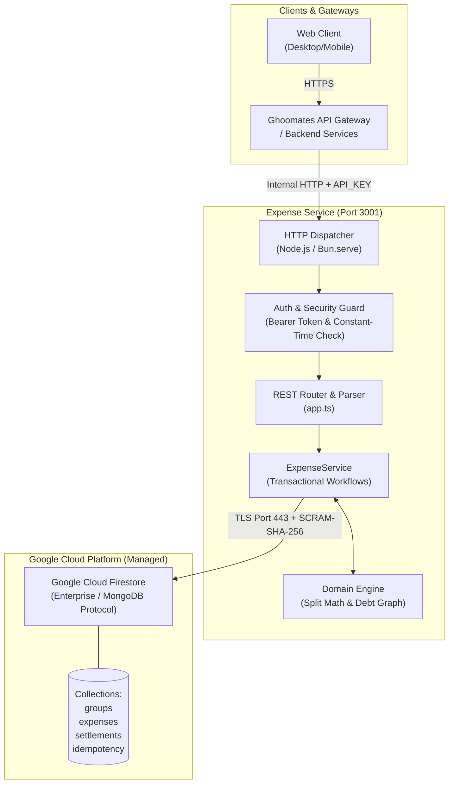
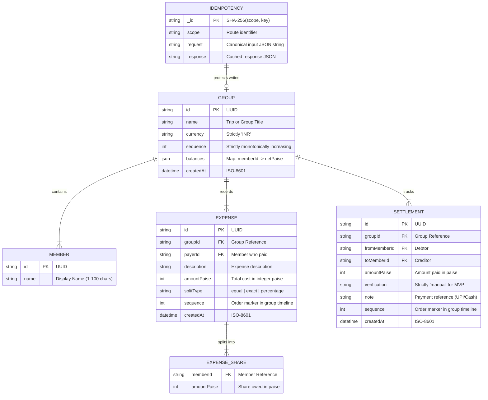
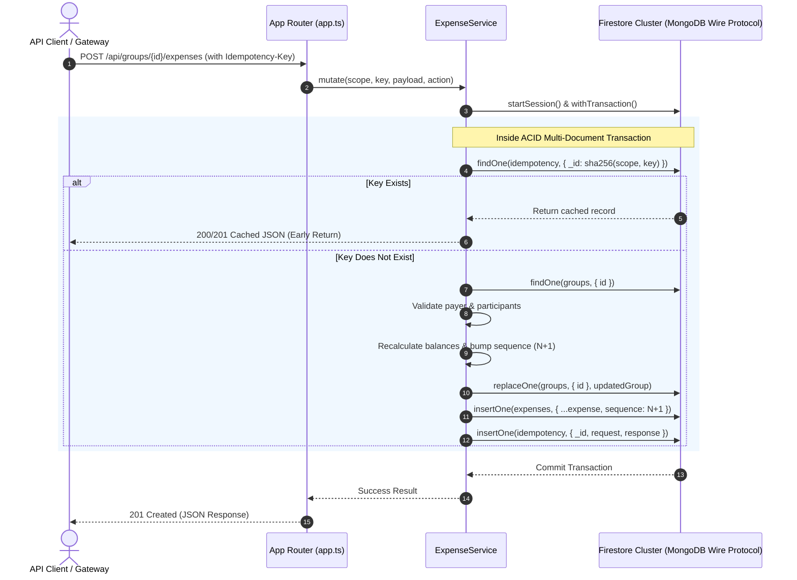

# Backend Architecture & Design Document
**Service:** `expense-service`  
**Monorepo Path:** `backend/expense-service`  
**Ecosystem:** Ghoomates Travel Companion Platform  
**Runtimes:** Node.js (v22+) / Bun (v1.3+) &bull; **Database:** Google Cloud Firestore (MongoDB Protocol)

---

## 1. Executive Summary & Core Objectives

`expense-service` is an independently deployable microservice within the **Ghoomates** monorepo responsible for multi-traveler group expense sharing, real-time ledger accounting, debt minimization, and manual settlement verification.

### Key Tenets
1. **Zero Financial Precision Drift**: No floating-point numbers are used for monetary calculations. All amounts are stored and calculated as 64-bit integer **paise** ($1\text{ INR} = 100\text{ paise}$).
2. **ACID Transactional Consistency**: All balance mutations, sequential audit logs, and idempotency states execute within multi-document database transactions.
3. **Strict Idempotency**: All state-modifying requests require a unique `Idempotency-Key` header hashed via SHA-256 to prevent duplicate charges or double payments.
4. **Platform & Runtime Neutrality**: Operates on both standard Node.js and Bun without external web framework dependencies (built on standard Web Fetch & Streams primitives).

---

## 2. High-Level System Architecture



---

## 3. Data Model & Entity Relationships

The service maintains an append-only transaction history alongside denormalized group aggregates to ensure $O(1)$ balance reads without scanning full historical transactions.



---

## 4. Algorithmic Domain Logic

### 4.1. Lossless Expense Splitting (`splitExpense`)

Splitting currency among $N$ individuals frequently results in non-divisible fractional cents (e.g. splitting ₹100.00 among 3 participants yields $33.3333...$ paise).

To eliminate rounding leaks:
1. Base shares are computed via integer division:
   $$\text{baseShare}_i = \left\lfloor \frac{\text{amount} \times w_i}{\sum w} \right\rfloor$$
2. The remaining undistributed paise:
   $$\text{remainder} = \text{amount} - \sum \text{baseShare}_i$$
3. Fractional remainder paise ($1\text{ paise}$ each) are distributed sequentially to participants sorted by highest fractional modulo, ensuring:
   $$\sum_{i=1}^N \text{shares}_i = \text{totalAmount}$$
   *Guaranteed: Zero paise created or lost.*

### 4.2. Debt Minimization (`suggestTransfers`)

When a trip ends with complex inter-member balances, a naive settlement requires up to $\frac{N(N-1)}{2}$ transactions.

The service implements a **Greedy Bipartite Settlement Algorithm**:
1. Partition members into **Debtors** ($\text{netPaise} < 0$) and **Creditors** ($\text{netPaise} > 0$).
2. Sort creditors descending by largest surplus, and debtors ascending by largest debt.
3. Greedily pair the largest debtor with the largest creditor:
   $$\text{transfer} = \min(|\text{debt}|, \text{credit})$$
4. Adjust remaining balances and repeat until all net balances reach exactly $0$.
5. **Result**: Reduces transactions to at most $N-1$ transfers.

---

## 5. Concurrency Control & Idempotency Architecture



---

## 6. Storage & Database Tier

### Google Cloud Firestore via MongoDB Protocol
The service connects to Google Cloud Firestore using the MongoDB wire protocol on port 443. This combines serverless autoscaling with standard MongoDB driver ergonomics.

#### Connection Parameters

| Parameter | Required Value | Rationale |
| :--- | :--- | :--- |
| **`loadBalanced`** | `true` | Required by Firestore Enterprise serverless endpoint. |
| **`tls`** | `true` | Enforces TLS 1.3 encryption over public port 443. |
| **`authMechanism`** | `SCRAM-SHA-256` | Secure credential exchange without plaintext transit. |
| **`retryWrites`** | `false` | Firestore handles atomic operations natively. |

#### Database Indexes

| Collection | Index Key | Unique | Purpose |
| :--- | :--- | :--- | :--- |
| `groups` | `{ id: 1 }` | **Yes** | Primary key lookups for group state. |
| `expenses` | `{ groupId: 1, sequence: -1 }` | No | Chronological reverse-pagination feed. |
| `settlements` | `{ groupId: 1, sequence: -1 }` | No | Chronological payment history. |
| `idempotency` | `{ _id: 1 }` | **Yes** | Constant-time duplicate detection. |

---

## 7. Security Architecture

1. **Internal Authentication Barrier**:
   - Access requires a secret bearer token of $\ge 32$ characters.
   - Evaluated via `crypto.timingSafeEqual` to eliminate timing attack vectors.
2. **Payload Protection**:
   - Maximum body size enforced at 64 KiB to prevent memory exhaustion / DoS attacks.
   - Malformed JSON and missing content-type headers fail early with standardized HTTP 400/415.
3. **No PII or Credentials in Storage**:
   - Only trip nicknames and opaque UUIDs are stored.
   - `.env` files are strictly gitignored and excluded from Docker / Cloud builds via `.dockerignore` and `.gcloudignore`.

---

## 8. Deployment & Operational Checklist

```text
Local Dev (Port 3001) ---> Cloud Run (Port 8080)
   ├── Node 22+ / Bun          ├── Distroless Container
   ├── Direct TLS connection   ├── Managed VPC & Secret Manager
   └── Automatic .env loader   └── Zero-trust Service Account (datastore.user)
```

### Health Probes & Monitoring
- **Liveness & Readiness**: `GET /health` returns `200 {"status":"ok"}` without database locking overhead, suitable for Cloud Run / Kubernetes probes.
- **Graceful Shutdown**: Intercepts `SIGINT` and `SIGTERM` to close HTTP listeners, end active sessions, and terminate MongoDB client pools cleanly without dropping in-flight transactions.

